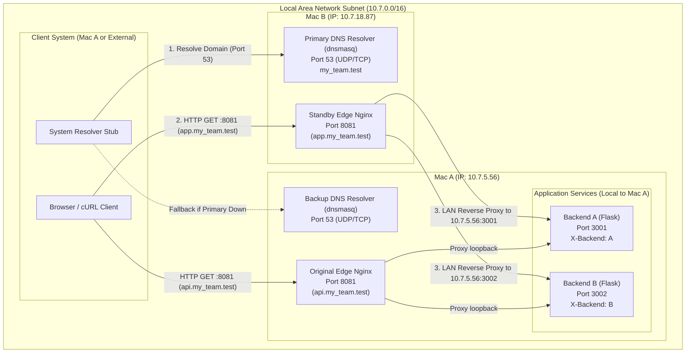

# Computer Networks Project — Phase 1 & Phase 2

## Project Overview

This repository contains the complete implementation, configurations, evidence documentation, and architecture specifications for both **Phase 1** and **Phase 2** of the Computer Networks project.

- **Phase 1**: Single-host dual-backend load-balanced service using Python Flask and open-source Nginx.
- **Phase 2**: Multi-host distributed network edge, redundant DNS resolvers (`dnsmasq`), controlled traffic cutover, service isolation via macOS PF firewall, and fault diagnostic protocols.

---

## Team Members

- **Yashvi Goyal**
- **Mouli Srivastava**

---

## Phase 1 vs. Phase 2: Key Differences

| Architectural Dimension | Phase 1 (Single-Host Baseline) | Phase 2 (Distributed Dual-Host) |
|---|---|---|
| **Physical Nodes** | Single MacBook (`localhost` / `127.0.0.1`) | Two physical MacBooks (**Mac A** & **Mac B**) on LAN (`10.7.0.0/16`) |
| **DNS Resolution** | None / Static loopback (`/etc/hosts`) | Redundant DNS resolvers (`dnsmasq`) on Mac B (Primary) and Mac A (Backup) |
| **Edge Reverse Proxy** | Local Nginx on Mac A (`localhost:8081`) | Migrated Standby Nginx on Mac B (`10.7.18.87:8081`) proxying across LAN |
| **Application Backends** | Backend A (`:3001`) and Backend B (`:3002`) on Mac A | Backend A (`:3001`) and Backend B (`:3002`) hosted on Mac A |
| **Traffic Ingress** | Direct to local Nginx | DNS-driven cutover for `app.my_team.test` to Mac B edge proxy |
| **Network Security** | Unrestricted local port access | Host perimeter isolation on Mac A using macOS PF firewall (`pfctl`) |
| **Failure Scope** | Host failure drops entire system | DNS and edge redundancy isolate node-level service faults |

---

## Phase 2 Network Architecture



> [!IMPORTANT]
> **Host Placement Detail**: Both application backends (**Backend A** and **Backend B**) run on **Mac A**. **Mac B** provides the standby Nginx edge reverse proxy and primary DNS resolver. Mac B proxies client requests across the physical LAN to `10.7.5.56:3001` and `10.7.5.56:3002`.

---

## Phase 2 Extensions & Implementation Status

| Extension | Title / Objective | Status | Summary |
|---|---|:---:|---|
| **Extension A** | Backup DNS Resolver | **Completed** | Primary `dnsmasq` on Mac B (`10.7.18.87`), backup `dnsmasq` on Mac A (`10.7.5.56`). Client DNS failover verified. |
| **Extension B** | DNS TTL & Record Change | **Partially Completed** | 30s TTL evaluated using Python `dnslib` caching harness; live cross-browser capture marked inconclusive. |
| **Extension C** | Service Isolation | **Completed & Rolled Back** | macOS PF firewall anchor `com.local.backend-isolation` restricted LAN access to ports 3001/3002; rules verified and subsequently disabled. |
| **Extension D** | High Availability Failover | **Previously Demonstrated** | Open-source Nginx passive health checks (`max_fails=1 fail_timeout=10s`, `proxy_next_upstream`) demonstrated in Phase 1. |
| **Extension E** | Controlled Edge Migration | **Completed** | Standby Nginx on Mac B configured and verified. DNS cutover redirected `app.my_team.test` to Mac B. |
| **Extension F** | Faculty Troubleshooting Challenge | **Methodology Documented** | Formal challenge skipped; structured 4-tier diagnostic framework established and documented. |

---

## Phase 2 Directory Navigation

- [**Phase 2 Overview**](phase2/README.md)
- **Architecture Documentation**:
  - [Network Topology](phase2/architecture/network-topology.md)
  - [IP Addressing & Interface Specs](phase2/architecture/ip-addressing.md)
  - [Request Flow & Sequence Diagrams](phase2/architecture/request-flow.md)
- **Configuration Bundle**:
  - [Configurations README & Deployment Guide](phase2/configs/README.md)
  - [Primary DNS Config (Mac B)](phase2/configs/dnsmasq/primary-dnsmasq.conf)
  - [Backup DNS Config (Mac A)](phase2/configs/dnsmasq/backup-dnsmasq.conf)
  - [Original Nginx Config (Mac A)](phase2/configs/nginx/original-mac-a-nginx.conf)
  - [Standby Nginx Config (Mac B)](phase2/configs/nginx/standby-mac-b-nginx.conf)
  - [macOS PF Firewall Rules](phase2/configs/firewall/pf-backend-isolation.conf) & [Management Script](phase2/configs/firewall/pf-setup.sh)
- **Evidence Index & Artifacts**:
  - [Master Evidence Index](phase2/evidence/README.md)
  - [Extension A Evidence (Backup DNS)](phase2/evidence/backup-dns/README.md)
  - [Extension B / E4 Evidence (TTL & Caching)](phase2/evidence/ttl-migration/README.md)
  - [Extension C Evidence (PF Firewall)](phase2/evidence/firewall-isolation/README.md)
  - [Extension D Evidence (Failover)](phase2/evidence/failover/README.md)
  - [Extension E Evidence (Edge Migration)](phase2/evidence/edge-migration/README.md)
  - [Extension F Diagnostic Framework](phase2/evidence/troubleshooting/README.md)
- **Formal Technical Report**:
  - [Final Project Report (PDF)](report/Private_Network_Service_Platform_Report.pdf)
- **Presentation & Evaluation**:
  - [Slide-by-Slide Presentation Outline](phase2/presentation/presentation-outline.md)
  - [Final Live Demonstration Script & Viva Q&A](phase2/presentation/demo-script.md)

---

## Quick Verification Commands for Phase 2

### 1. Test DNS Resolution:
```bash
# Query primary DNS on Mac B
dig @10.7.18.87 app.my_team.test +short
# Expected output: 10.7.18.87

# Query backup DNS on Mac A
dig @10.7.5.56 api.my_team.test +short
# Expected output: 10.7.5.56
```

### 2. Test Edge Migration & Load Balancing on Mac B:
```bash
# Query standby Nginx on Mac B (Host header routes to app.my_team.test)
curl -i http://10.7.18.87:8081/api/status -H "Host: app.my_team.test"
# Headers received: X-Backend: A or B, X-Proxy-Edge: Mac-B-Standby
```

### 3. Test Service Isolation (Mac A PF Firewall):
```bash
# Enable isolation anchor
sudo ./phase2/configs/firewall/pf-setup.sh enable

# Test status and counters
sudo ./phase2/configs/firewall/pf-setup.sh status

# Revert and disable firewall
sudo ./phase2/configs/firewall/pf-setup.sh disable
```

---
---

# Phase 1 Documentation (Preserved Baseline)

## Computer Networks Phase 1 — Backend Servers

### Project Overview

This repository contains the two Flask backend servers developed for the Computer Networks Phase 1 project.

The project consists of two independent backend applications:

- **Backend A** — runs on port `3001`
- **Backend B** — runs on port `3002`

Both backends provide HTTP endpoints and identify themselves using the `X-Backend` response header.

---

### Repository Structure

```text
CN_Phase1/
│
├── backend-a/
│   └── app.py
│
├── backend-b/
│   └── app.py
│
└── README.md
```

Each backend has its own Python virtual environment.

After setup, the local structure will be:

```text
CN_Phase1/
│
├── backend-a/
│   ├── app.py
│   └── venv/
│
├── backend-b/
│   ├── app.py
│   └── venv/
│
└── README.md
```

The `venv` directories are local virtual environments and should not be committed to GitHub.

---

# Requirements

* macOS
* Python 3
* pip
* Flask
* Git

---

# 1. Check Python Installation

Open Terminal and run:

```bash
python3 --version
```

Example output:

```text
Python 3.x.x
```

If Python 3 is installed, continue with the setup.

---

# 2. Clone the Repository

Clone the repository using:

```bash
git clone https://github.com/yg2505/CN_Phase1.git
```

Move into the project directory:

```bash
cd CN_Phase1
```

Check the contents:

```bash
ls
```

Expected structure:

```text
backend-a
backend-b
README.md
```

---

# 3. Backend A Setup

Backend A is the first Flask backend.

### Port

```text
3001
```

## Step 1 — Navigate to Backend A

```bash
cd backend-a
```

## Step 2 — Create a Virtual Environment

Create a Python virtual environment:

```bash
python3 -m venv venv
```

This creates a separate Python environment inside the `backend-a` directory.

## Step 3 — Install Flask

Install Flask using the Python executable inside the virtual environment:

```bash
./venv/bin/python -m pip install Flask
```

## Step 4 — Start Backend A

Start the backend using:

```bash
./venv/bin/python app.py
```

Backend A will run on port:

```text
3001
```

Keep this Terminal window open while Backend A is running.

---

# 4. Backend A API

Backend A provides two endpoints.

## Home Endpoint

```text
/
```

## Status Endpoint

```text
/api/status
```

The status endpoint returns:

```json
{
  "backend": "A",
  "status": "ok"
}
```

The response also contains the following HTTP response header:

```text
X-Backend: A
```

This header identifies Backend A as the server that processed the request.

---

# 5. Test Backend A

With Backend A running, open another Terminal window and run:

```bash
curl -i http://localhost:3001/
```

To test the status endpoint:

```bash
curl -i http://localhost:3001/api/status
```

The response should contain:

```text
X-Backend: A
```

and:

```json
{
  "backend": "A",
  "status": "ok"
}
```

---

# 6. Check Backend A Port

To verify that Backend A is listening on port `3001`, run:

```bash
lsof -nP -iTCP:3001 -sTCP:LISTEN
```

A Python process should be shown as listening on port `3001`.

---

# 7. Backend B Setup

Backend B is the second Flask backend.

### Port

```text
3002
```

Open a second Terminal window.

## Step 1 — Navigate to Backend B

From the project directory:

```bash
cd backend-b
```

If starting from the home directory, use:

```bash
cd CN_Phase1/backend-b
```

## Step 2 — Create a Virtual Environment

```bash
python3 -m venv venv
```

## Step 3 — Install Flask

```bash
./venv/bin/python -m pip install Flask
```

## Step 4 — Start Backend B

```bash
./venv/bin/python app.py
```

Backend B will run on port:

```text
3002
```

Keep this Terminal window open while Backend B is running.

---

# 8. Backend B API

Backend B provides two endpoints.

## Home Endpoint

```text
/
```

## Status Endpoint

```text
/api/status
```

The status endpoint returns:

```json
{
  "backend": "B",
  "status": "ok"
}
```

The response also contains the following HTTP response header:

```text
X-Backend: B
```

This header identifies Backend B as the server that processed the request.

---

# 9. Test Backend B

With Backend B running, open another Terminal window and run:

```bash
curl -i http://localhost:3002/
```

To test the status endpoint:

```bash
curl -i http://localhost:3002/api/status
```

The response should contain:

```text
X-Backend: B
```

and:

```json
{
  "backend": "B",
  "status": "ok"
}
```

---

# 10. Check Backend B Port

To verify that Backend B is listening on port `3002`, run:

```bash
lsof -nP -iTCP:3002 -sTCP:LISTEN
```

A Python process should be shown as listening on port `3002`.

---

# 11. Running Both Backends

Both backends need to run simultaneously during testing.

Use two Terminal windows.

## Terminal 1 — Backend A

```bash
cd CN_Phase1/backend-a
./venv/bin/python app.py
```

Backend A:

```text
Port: 3001
```

## Terminal 2 — Backend B

```bash
cd CN_Phase1/backend-b
./venv/bin/python app.py
```

Backend B:

```text
Port: 3002
```

Both Terminal windows should remain open.

---

# 12. Fresh Setup — Both Backends

If setting up the project on a new Mac from scratch, use the following commands.

## Backend A

```bash
cd CN_Phase1/backend-a
python3 -m venv venv
./venv/bin/python -m pip install Flask
./venv/bin/python app.py
```

## Backend B

Open a second Terminal window:

```bash
cd CN_Phase1/backend-b
python3 -m venv venv
./venv/bin/python -m pip install Flask
./venv/bin/python app.py
```

After these steps:

```text
Backend A → Port 3001
Backend B → Port 3002
```

---

# 13. Verify Both Backends

After starting both servers, verify Backend A:

```bash
curl -i http://localhost:3001/api/status
```

Expected backend identification:

```text
X-Backend: A
```

Verify Backend B:

```bash
curl -i http://localhost:3002/api/status
```

Expected backend identification:

```text
X-Backend: B
```

---

# 14. Verify Both Ports

Check Backend A:

```bash
lsof -nP -iTCP:3001 -sTCP:LISTEN
```

Check Backend B:

```bash
lsof -nP -iTCP:3002 -sTCP:LISTEN
```

Both ports should have a Python process listening.

---

# 15. Stopping the Backends

To stop a backend server, go to the Terminal window where it is running and press:

```text
Ctrl + C
```

For example, to stop Backend A:

```text
Backend A Terminal → Ctrl + C
```

To stop Backend B:

```text
Backend B Terminal → Ctrl + C
```

---

# 16. Starting the Backends Again

After stopping a backend, it can be started again using the existing virtual environment.

## Backend A

```bash
cd CN_Phase1/backend-a
./venv/bin/python app.py
```

## Backend B

```bash
cd CN_Phase1/backend-b
./venv/bin/python app.py
```

There is no need to recreate the virtual environment every time the server is started.

---

# 17. Backend Failure Testing

The backends can also be stopped individually to demonstrate backend failure.

## Stop Backend A

Press:

```text
Ctrl + C
```

in the Backend A Terminal.

Backend A will no longer listen on port `3001`.

Verify:

```bash
lsof -nP -iTCP:3001 -sTCP:LISTEN
```

## Restart Backend A

```bash
cd CN_Phase1/backend-a
./venv/bin/python app.py
```

---

## Stop Backend B

Press:

```text
Ctrl + C
```

in the Backend B Terminal.

Backend B will no longer listen on port `3002`.

Verify:

```bash
lsof -nP -iTCP:3002 -sTCP:LISTEN
```

## Restart Backend B

```bash
cd CN_Phase1/backend-b
./venv/bin/python app.py
```

---

# 18. Flask Installation Verification

The Flask installation can be checked using the virtual environment's Python executable.

For Backend A:

```bash
./venv/bin/python -c "import flask; print(flask.__version__)"
```

For Backend B:

```bash
./venv/bin/python -c "import flask; print(flask.__version__)"
```

If Flask is installed correctly, the installed Flask version will be displayed.

---

# 19. Virtual Environment Notes

Each backend has its own virtual environment:

```text
backend-a/venv/
backend-b/venv/
```

The virtual environments isolate the Python dependencies of each backend.

The backend applications are started directly using:

```bash
./venv/bin/python app.py
```

This avoids needing to activate the virtual environment manually.

---

# 20. GitHub Files

The following files should be committed to the repository:

```text
backend-a/app.py
backend-b/app.py
README.md
```

The following directories should not be committed:

```text
backend-a/venv/
backend-b/venv/
```

A `.gitignore` file can be added with:

```text
venv/
__pycache__/
*.pyc
.DS_Store
```

---

# 21. Quick Start

For a new setup:

## Backend A

```bash
cd CN_Phase1/backend-a
python3 -m venv venv
./venv/bin/python -m pip install Flask
./venv/bin/python app.py
```

## Backend B

Open a second Terminal:

```bash
cd CN_Phase1/backend-b
python3 -m venv venv
./venv/bin/python -m pip install Flask
./venv/bin/python app.py
```

The servers will run on:

```text
Backend A → 3001
Backend B → 3002
```

Test Backend A:

```bash
curl -i http://localhost:3001/api/status
```

Test Backend B:

```bash
curl -i http://localhost:3002/api/status
```

Expected backend headers:

```text
Backend A → X-Backend: A
Backend B → X-Backend: B
```

---

# 22. Backend Summary

| Backend   | Directory    |   Port | Status Endpoint | Header         |
| --------- | ------------ | -----: | --------------- | -------------- |
| Backend A | `backend-a/` | `3001` | `/api/status`   | `X-Backend: A` |
| Backend B | `backend-b/` | `3002` | `/api/status`   | `X-Backend: B` |

Both backend applications are implemented using Flask and are designed to run independently on the same machine.
