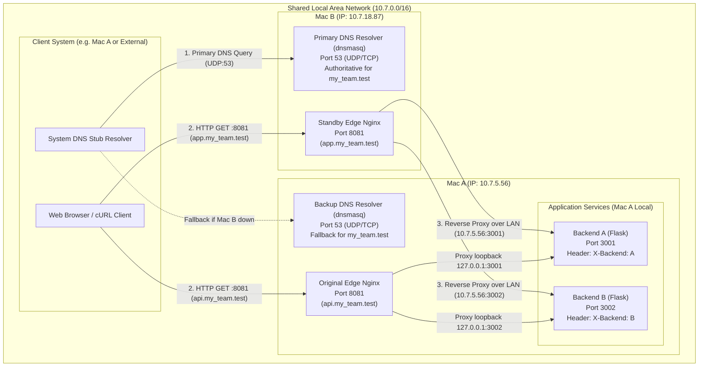

# Network Topology — Phase 2 Architecture

## 1. Physical and Logical Topology Overview

The Phase 2 environment is deployed across two physical Apple MacBooks connected to the same local area network (LAN) over Wi-Fi, operating within the IPv4 subnet `10.7.0.0/16`.

The logical architecture consists of:
- **Two DNS Resolvers**: Primary on Mac B (`10.7.18.87`), Backup on Mac A (`10.7.5.56`).
- **Two Nginx Edge Reverse Proxies**: Original edge on Mac A (`10.7.5.56:8081`), Standby edge on Mac B (`10.7.18.87:8081`).
- **Two Flask Backend Application Servers**: Both hosted locally on Mac A listening on ports `3001` (Backend A) and `3002` (Backend B).
- **Client System**: Issues DNS queries and HTTP requests. Either Mac or an external LAN peer acts as a client.

---

## 2. Structural Separation of Roles

### Physical Host Distinction
- **Mac A (`10.7.5.56`)**:
  - Serves as the application host running both Python Flask backends (`Backend A` on port 3001 and `Backend B` on port 3002).
  - Runs the **Backup DNS resolver** via `dnsmasq` on port 53.
  - Runs the **Original Nginx Edge** on port 8081, handling local proxying and traffic to `api.my_team.test`.
  - Hosts the macOS Packet Filter (PF) anchor `com.local.backend-isolation` to test network boundary enforcement.

- **Mac B (`10.7.18.87`)**:
  - Runs the **Primary DNS resolver** via `dnsmasq` on port 53, authoritative for `my_team.test`.
  - Runs the **Standby Nginx Edge** on port 8081. Following the controlled DNS migration, it serves incoming traffic for `app.my_team.test`.
  - Proxies HTTP requests across the LAN (`10.7.0.0/16`) to the backends residing on Mac A (`10.7.5.56:3001` and `10.7.5.56:3002`).

---

## 3. High Availability and Redundancy Characteristics

1. **DNS Redundancy**:
   - The client designates Mac B (`10.7.18.87`) as the primary nameserver and Mac A (`10.7.5.56`) as the secondary nameserver.
   - If the primary DNS process halts or becomes unreachable, the client falls back to Mac A with no disruption to zone resolution.

2. **Edge Proxy Migration & Load Balancing**:
   - Nginx on Mac B acts as the active edge for the web tier (`app.my_team.test`), performing round-robin load distribution across the two backends on Mac A.
   - Passive health monitoring (`max_fails=1 fail_timeout=10s`) ensures that if Backend A (3001) terminates, incoming requests are seamlessly routed exclusively to Backend B (3002) without generating client HTTP 502 Bad Gateway responses.

3. **Backend Service Isolation**:
   - Backends are protected from unauthorized direct network access via the macOS Packet Filter (`pfctl`), restricting external LAN clients from directly querying ports 3001 and 3002 while allowing the reverse proxy to mediate all communication.
