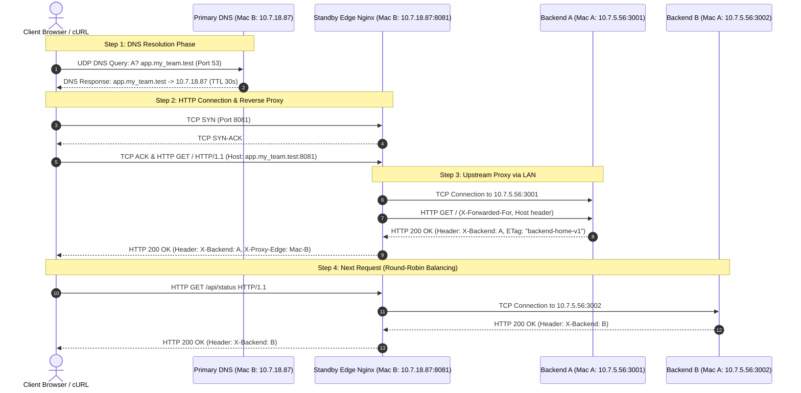
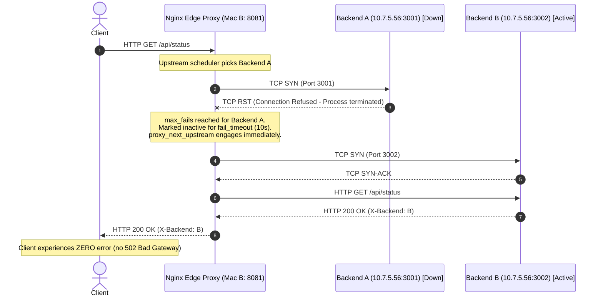
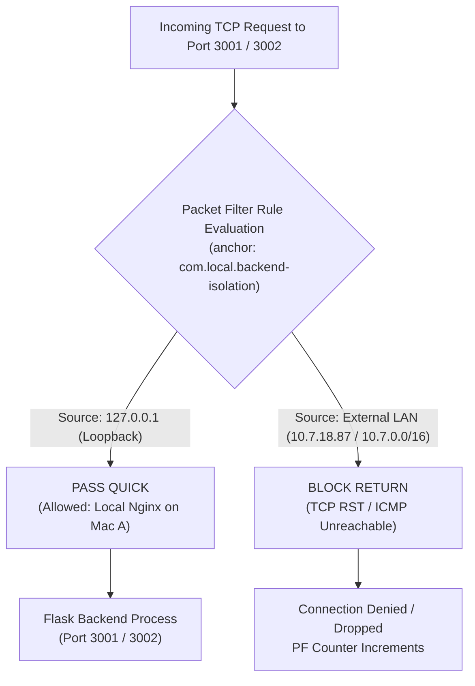

# Network Request and Traffic Flow

This document details the step-by-step packet and transport flows across the Phase 2 system for DNS resolution, edge proxying, backend failover, and firewall isolation.

---

## 1. End-to-End Client Request Flow (Post Edge-Migration)

Following the controlled edge migration of `app.my_team.test` to Mac B (`10.7.18.87`), client requests follow this path:



---

## 2. DNS Resolver Failover Flow (Extension A)

When the Primary DNS server on Mac B experiences service failure or becomes unreachable, the client resolver switches to the Backup DNS server on Mac A.

```mermaid
sequenceDiagram
    autonumber
    actor Client as Client Resolver Stub
    participant DNS_B as Primary DNS (Mac B: 10.7.18.87:53)
    participant DNS_A as Backup DNS (Mac A: 10.7.5.56:53)

    Client->>DNS_B: UDP Query: A? app.my_team.test (Timeout timer starts)
    Note over DNS_B: Primary process stopped or unreachable (Port closed / silent drop)
    Client-xDNS_B: Timeout / ICMP Port Unreachable
    Note over Client: Fallback triggered to secondary nameserver in resolver list
    Client->>DNS_A: UDP Query: A? app.my_team.test
    DNS_A-->>Client: DNS Answer: 10.7.18.87 (TTL 30s)
    Note over Client: Resolution succeeds seamlessly; IP cached locally
```

---

## 3. High Availability Passive Backend Failover (Extension D)

Open-source Nginx employs **passive health checks** configured via the upstream parameters `max_fails` and `fail_timeout`.



---

## 4. Firewall Service Isolation Flow (Extension C)

The macOS PF rules in anchor `com.local.backend-isolation` enforce network perimeter security around backend ports `3001` and `3002`.


