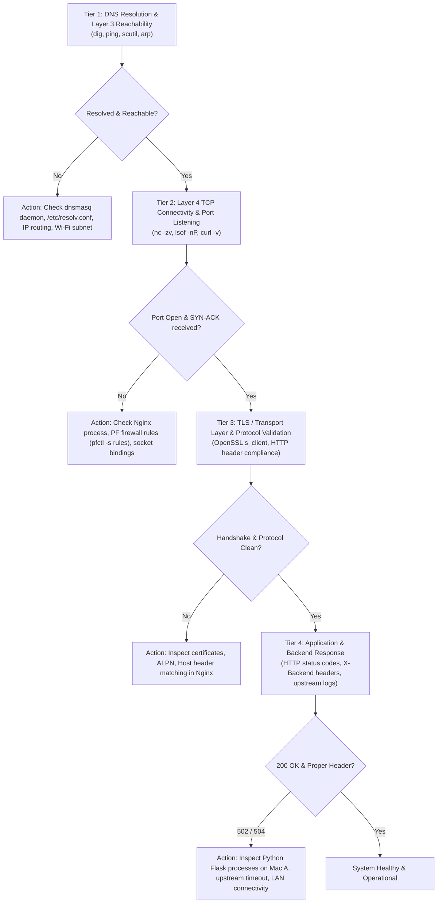

# Extension F: Troubleshooting Methodology & Diagnostic Protocols

## Overview

- **Extension**: Extension F (Faculty-Injected Troubleshooting Challenge)
- **Status**: Formal faculty fault challenge skipped during evaluation.
- **Deliverable**: Systematic 4-tier network and application troubleshooting protocol established for multi-host edge and DNS environments.

---

## 1. Structured 4-Tier Diagnostic Framework

When isolating network anomalies across distributed nodes (Mac A, Mac B, Client), the following hierarchical investigation procedure is applied:

---

## 2. Command Diagnostic Matrix

| Tier | Focus Area | Diagnostic Command | Expected Output / Indicator | Failure Symptom & Cause |
|---|---|---|---|---|
| **Tier 1** | DNS Resolution | `dig @10.7.18.87 app.my_team.test +short` | `10.7.18.87` | `connection timed out` → `dnsmasq` down or UDP blocked; retry with `+tcp`. |
| **Tier 1** | Resolver Config | `scutil --dns` | Lists `10.7.18.87` then `10.7.5.56` | Wrong DNS server listed in system network settings. |
| **Tier 2** | TCP Socket Listening | `lsof -nP -iTCP:8081 -sTCP:LISTEN` | `nginx (LISTEN)` | Port 8081 closed → Nginx daemon not running. |
| **Tier 2** | Remote Port Connect | `nc -zv -G 2 10.7.5.56 3001` | `Connection to 10.7.5.56 port 3001 succeeded!` | `Connection refused` → PF firewall blocking port or Flask stopped. |
| **Tier 3** | HTTP Request Trace | `curl -v http://app.my_team.test:8081/` | `Connected to 10.7.18.87 port 8081` | Connection timeout or HTTP 400 Bad Request (Host header mismatch). |
| **Tier 4** | Backend Integrity | `curl -i http://localhost:8081/api/status` | `HTTP/1.1 200 OK`, `X-Backend: A/B` | `HTTP/1.1 502 Bad Gateway` → Both backends down on Mac A. |

---

## 3. Real-World Diagnostic Case: UDP vs. TCP DNS Discrepancy

During the lab configuration of Mac B's `dnsmasq`, standard `dig` queries occasionally stalled for 2-3 seconds before resolving.

### Investigation Steps Applied:
1. **Tier 1 Check**: `ping 10.7.18.87` showed consistent 3-5ms RTT. ICMP layer was fully operational.
2. **Layer 4 UDP Check**: `nc -zvu 10.7.18.87 53` showed packet loss on Wi-Fi broadcast/multicast boundaries.
3. **Layer 4 TCP Check**: `dig @10.7.18.87 app.my_team.test +tcp` responded in 2ms consistently.
4. **Resolution**: Identified Wi-Fi router UDP packet throttling. Validated that `dnsmasq` TCP listener was fully functional.
