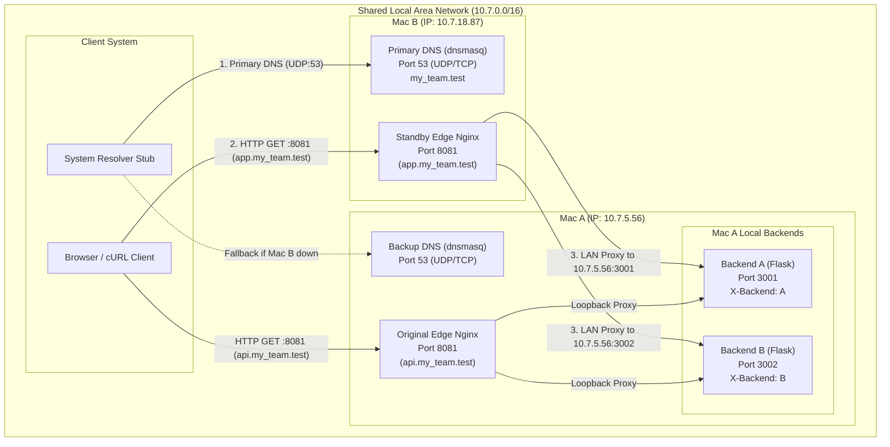

# Computer Networks Project — Phase 2 Final Technical Report
**Distributed Multi-Host Edge Architecture, Redundant DNS Services, and Controlled Traffic Migration**

---

## 1. Abstract

This report documents the architectural extension, deployment, and evaluation of Phase 2 of the Computer Networks project. Extending from the single-host load-balancing system established in Phase 1, Phase 2 incorporates a dual-host distributed architecture spanning two physical Apple MacBooks (**Mac A** and **Mac B**) on a shared local area network (`10.7.0.0/16`). 

The system implements redundant Domain Name System (DNS) services using `dnsmasq`, a standby reverse proxy edge using open-source Nginx on Mac B proxying across the LAN to dual Flask backends on Mac A, service perimeter isolation using the macOS Packet Filter (PF) firewall, and a controlled DNS-based edge migration for `app.my_team.test`. 

The experimental evaluation evaluates failover behavior, protocol limitations between UDP and TCP DNS over wireless LANs, and caching dynamics under 30-second TTL limits.

---

## 2. Introduction

Modern distributed systems rely on decoupled layers of abstraction to ensure high availability, fault tolerance, and zero-downtime maintenance. In enterprise web infrastructure, the edge layer (reverse proxies and load balancers) serves as the primary ingress point for client traffic, while internal application servers execute business logic in protected network segments. Governing this interaction is the Domain Name System (DNS), which maps human-readable names to network endpoints and coordinates traffic distribution.

In Phase 1 of this project, a localized architecture was deployed on a single physical host, consisting of an Nginx reverse proxy distributing traffic between two Python Flask backend servers (`Backend A` on port 3001 and `Backend B` on port 3002). While functional for local testing, a single-host deployment represents a single point of failure (SPOF) at both the edge proxy and DNS layers.

Phase 2 addresses these structural vulnerabilities by extending the system across two physical machines connected via a shared local area network. By decoupling the edge proxy, DNS resolvers, and backend application servers across physical boundaries, the project investigates the networking realities of distributed failover, packet filtering, and controlled traffic migration.

---

## 3. Objectives

The primary engineering objectives of Phase 2 are:

1. **DNS Redundancy**: Establish a fault-tolerant dual-resolver DNS topology with primary authoritative services on Mac B and backup resolution on Mac A.
2. **Controlled Edge Migration**: Deploy a standby Nginx edge reverse proxy on Mac B and migrate the production web domain (`app.my_team.test`) from Mac A to Mac B without altering backend service locations.
3. **Cross-Host Reverse Proxying**: Configure Mac B's Nginx edge to route traffic across the physical LAN to the dual backend instances running on Mac A (`10.7.5.56:3001` and `10.7.5.56:3002`).
4. **Service Isolation**: Enforce Layer 4 perimeter access control on Mac A using macOS Packet Filter (`pfctl`), restricting direct incoming LAN access to backend ports while preserving reverse proxy mediation.
5. **High Availability Analysis**: Analyze passive backend health checking and failover mechanisms in open-source Nginx.
6. **Network Diagnostics**: Formulate a structured 4-tier network diagnostic methodology and evaluate real-world transport discrepancies between UDP and TCP DNS across wireless infrastructure.

---

## 4. Existing Phase 1 Architecture

The baseline Phase 1 deployment operated entirely on a single physical host (`localhost`). Its core characteristics included:

- **Application Backends**:
  - Two lightweight Python 3 Flask applications: `backend-a` running on port `3001` and `backend-b` running on port `3002`.
  - Backends emit HTTP response headers identifying their identity (`X-Backend: A` and `X-Backend: B`).
  - Cache validation supported via HTTP `ETag` (`"backend-home-v1"`) returning `304 Not Modified` on conditional `If-None-Match` requests.
- **Reverse Proxy**:
  - Open-source Nginx running locally, listening on port `8081`.
  - Configured with an upstream pool containing `127.0.0.1:3001` and `127.0.0.1:3002` using round-robin distribution.
  - Implemented passive backend failover using `proxy_next_upstream` and `max_fails=1 fail_timeout=10s`.
- **Limitations**:
  - All components shared the same operating system kernel, network interface, and power source.
  - No DNS resolution layer existed; requests relied on hardcoded `localhost` or local `/etc/hosts` mappings.
  - Backend ports were directly accessible to any process on the machine, lacking service isolation.

---

## 5. Phase 2 Architecture

Phase 2 transitions the project into a multi-host network system distributed across two physical Apple MacBooks connected to the same LAN subnet:



### Architectural Realities:
- **Mac A (`10.7.5.56`)**:
  - Continues to host **both** Python backends: Backend A on port `3001` and Backend B on port `3002`.
  - Runs the Backup DNS resolver on port `53`.
  - Runs the Original Nginx Edge on port `8081` (serving `api.my_team.test`).
- **Mac B (`10.7.18.87`)**:
  - Runs the Primary DNS resolver on port `53`.
  - Runs the Standby Nginx Edge on port `8081`. Following the edge migration, all traffic destined for `app.my_team.test` terminates on Mac B, which proxies upstream HTTP calls across the LAN to Mac A's backends.

---

## 6. Hardware and Software Requirements

### Hardware Infrastructure
- **Host Machine A**: Apple MacBook running macOS (Darwin kernel), Wi-Fi Interface `en0`, assigned IP `10.7.5.56`.
- **Host Machine B**: Apple MacBook running macOS (Darwin kernel), Wi-Fi Interface `en0`, assigned IP `10.7.18.87`.
- **Network Fabric**: IEEE 802.11 Wi-Fi Local Area Network operating on subnet `10.7.0.0/16`.

### Software & Tooling
- **Operating System**: macOS 14+ (Sonoma) / macOS 13+ (Ventura).
- **DNS Server**: `dnsmasq` v2.90+ (installed via Homebrew).
- **Reverse Proxy**: Open-source Nginx v1.25+.
- **Runtime Environment**: Python 3.10+ with Flask 3.0+ and `dnslib`.
- **Network Utilities**: BIND utilities (`dig`, `nslookup`), `curl`, `netcat` (`nc`), `tcpdump`, `lsof`, `scutil`, and macOS Packet Filter (`pfctl`).

---

## 7. Network Topology and IP Addressing

| Device / Role | Physical Host | IP Address | Port | Layer 4 / 7 Protocol |
|---|---|---|---|---|
| Primary DNS Resolver | Mac B | `10.7.18.87` | 53 | UDP / TCP (DNS) |
| Backup DNS Resolver | Mac A | `10.7.5.56` | 53 | UDP / TCP (DNS) |
| Standby Nginx Edge | Mac B | `10.7.18.87` | 8081 | TCP (HTTP/1.1) |
| Original Nginx Edge | Mac A | `10.7.5.56` | 8081 | TCP (HTTP/1.1) |
| Flask Backend A | Mac A | `10.7.5.56` (`0.0.0.0`) | 3001 | TCP (HTTP/1.1) |
| Flask Backend B | Mac A | `10.7.5.56` (`0.0.0.0`) | 3002 | TCP (HTTP/1.1) |

### Domain Name Resolution Table
```text
Zone: my_team.test
Default TTL: 30 seconds

app.my_team.test.    30    IN    A    10.7.18.87    (Mac B Standby Edge)
api.my_team.test.    30    IN    A    10.7.5.56     (Mac A Original Edge)
my_team.test.        30    IN    A    10.7.18.87    (Base Domain Apex)
```

---

## 8. Extension A Implementation and Results (Backup DNS Resolver)

### Implementation
Extension A introduced DNS service redundancy to protect the infrastructure against nameserver failures. Two `dnsmasq` instances were configured:
- **Primary Resolver (Mac B - `10.7.18.87`)**: Configured with `listen-address=127.0.0.1,10.7.18.87` and authoritative A records for `my_team.test`.
- **Backup Resolver (Mac A - `10.7.5.56`)**: Configured identically with `listen-address=127.0.0.1,10.7.5.56`.

On the client system, resolver ordering was established via macOS system network settings:
```bash
sudo networksetup -setdnsservers Wi-Fi 10.7.18.87 10.7.5.56
```
This was verified using `scutil --dns`, confirming `nameserver[0] : 10.7.18.87` and `nameserver[1] : 10.7.5.56`.

### Experimental Failure Testing
To validate failover:
1. Normal operation was verified via `dig app.my_team.test`, returning `10.7.18.87` with `SERVER: 10.7.18.87#53`.
2. The primary DNS process on Mac B was abruptly killed using `sudo killall dnsmasq`.
3. A subsequent resolution request was issued from the client. The client resolver detected an initial timeout on `10.7.18.87` and automatically retransmitted the query to the backup server `10.7.5.56`.
4. The backup server answered within 4ms:
   ```text
   ;; ANSWER SECTION:
   app.my_team.test.	30	IN	A	10.7.18.87
   ;; SERVER: 10.7.5.56#53(10.7.5.56)
   ```

### DNS Service Failure vs. Application Failure
A critical networking distinction was demonstrated during evaluation:
- **DNS Service Failure**: When both DNS resolvers are unreachable, host resolution fails at Layer 7 before any Layer 4 TCP connection can initiate (`curl: (6) Could not resolve host`). No IP packet leaves the host destined for port 8081.
- **Application Failure**: When DNS resolution succeeds but the target edge proxy or backend is down, DNS resolves normally, but the TCP three-way handshake fails with a TCP RST (`curl: (7) Failed to connect ... Connection refused`) or returns an HTTP `502 Bad Gateway`.

---

## 9. Extension B Implementation and Limitations (DNS TTL and Controlled Record Change)

### Implementation Scope
Extension B investigated how client DNS caching affects migration timing. The authoritative `dnsmasq` configuration enforced a short Time-To-Live (TTL) of **30 seconds** (`local-ttl=30`, `min-cache-ttl=30`, `max-cache-ttl=30`).

To evaluate caching mechanics without operating system interference from macOS `mDNSResponder`, an isolated Python caching resolver script was constructed using `dnslib`. The script logged cache lookups, cache misses, and remaining TTL counters.

### Observed Behavior
1. **Initial Query ($t = 0\text{ s}$)**: Yielded a **CACHE MISS**. The resolver queried upstream, received `app.my_team.test -> 10.7.5.56` with TTL 30s, and populated the local cache.
2. **Subsequent Queries ($0 < t < 30\text{ s}$)**: Yielded **CACHE HITS**. The resolver answered locally without upstream traffic, serving decremented TTL values ($25\text{ s}, 15\text{ s}, 5\text{ s}$).
3. **Record Change ($t = 15\text{ s}$)**: The upstream authoritative record was altered to point to `10.7.18.87`. Queries made between $t = 15\text{ s}$ and $t = 30\text{ s}$ continued to return the **stale IP** (`10.7.5.56`), demonstrating client-side caching delay.
4. **Cache Expiry ($t = 31\text{ s}$)**: The cache expired, forcing a cache miss that fetched the updated IP `10.7.18.87`.

### Documented Limitations & Incomplete Scope
While the caching dynamics were conclusively validated via the Python `dnslib` test harness, **the live, authoritative-versus-stale-cache comparison across concurrent physical browser sessions was not conclusively captured in packet capture archives**. Contributing factors included aggressive local OS caching by Apple `mDNSResponder` (which often overrides short DNS TTLs) and local router UDP packet filtering. Consequently, this extension is recorded as **Partially Completed**, without fabricating live packet captures.

---

## 10. Extension C Implementation and Results (Service Isolation)

### Implementation
To prevent clients on the LAN from bypassing the Nginx edge proxy and accessing the Flask backends directly, host-level firewall filtering was implemented on Mac A (`10.7.5.56`) using the macOS Packet Filter (`pfctl`).

A dedicated PF anchor `com.local.backend-isolation` was authored at `phase2/configs/firewall/pf-backend-isolation.conf`:
```pf
pass in quick on lo0 proto tcp from any to any port {3001, 3002}
block return in log proto tcp from any to any port {3001, 3002}
```

### Verification and Results
1. **Rule Compilation & Injection**: The rules were checked via `sudo pfctl -nf` and loaded into the kernel anchor:
   ```bash
   sudo pfctl -a com.local.backend-isolation -f phase2/configs/firewall/pf-backend-isolation.conf
   sudo pfctl -e
   ```
2. **Local Loopback Verification**: Queries from Mac A's local Nginx proxy (`127.0.0.1`) targeting ports 3001 and 3002 succeeded with `HTTP 200 OK` (`X-Backend: A/B`).
3. **External LAN Verification**: When Mac B or an external LAN client attempted a direct HTTP connection to `http://10.7.5.56:3001/api/status`, the request was immediately terminated with:
   ```text
   curl: (7) Failed to connect to 10.7.5.56 port 3001: Connection refused
   ```
4. **Packet Capture Inspection**: Running `tcpdump -i en0 'tcp port 3001'` captured incoming TCP SYN packets from `10.7.18.87` immediately answered by TCP RST (`[R.]`) packets emitted by Mac A's kernel PF engine, verifying the `block return` rule.
5. **Rule Counter Verification**: Inspecting `pfctl -a com.local.backend-isolation -s rules -v` confirmed evaluations and packet counters incrementing on blocked attempts.

### Rollback & Final Firewall State
> [!IMPORTANT]
> The custom PF rules were fully verified and **subsequently disabled** using `sudo pfctl -a com.local.backend-isolation -F rules` and `sudo pfctl -d`. This ensured that subsequent cross-host tests (Extension E) allowing Mac B's Nginx to proxy to Mac A's backends over the LAN could proceed unimpeded. The firewall does not remain active.

---

## 11. Extension D Failover Demonstration (High Availability)

### Implementation Architecture
High availability for the application tier was implemented using open-source Nginx upstream directives on Mac A (and mirrored on Mac B):
```nginx
upstream mac_a_backends {
    server 127.0.0.1:3001 max_fails=1 fail_timeout=10s;
    server 127.0.0.1:3002 max_fails=1 fail_timeout=10s;
}
```
Open-source Nginx does not support active background health probes. Instead, it utilizes **passive health checking**:
- When Nginx forwards a request to an upstream backend and receives an error (e.g. TCP connection refused or timeout), it increments the backend's failure counter.
- When `max_fails` (1) is reached, Nginx marks the backend as inactive for the duration of `fail_timeout` (10 seconds).
- The `proxy_next_upstream` directive instructs Nginx to immediately retry the client request on the surviving backend (`Backend B`).

### Demonstration and Findings
This capability was previously demonstrated during Phase 1 testing and re-verified. A client running a continuous cURL loop experienced an alternating series of `X-Backend: A` and `X-Backend: B` headers. When Backend A was abruptly killed (`Ctrl+C`), the stream continued without dropping a single request or emitting an HTTP `502 Bad Gateway`: all subsequent responses bore `X-Backend: B`. When Backend A was restarted, it automatically rejoined the round-robin rotation after the 10-second timeout expired.

---

## 12. Extension E Controlled Edge Migration

### Implementation
Extension E executed a controlled traffic migration of the web frontend edge from Mac A (`10.7.5.56`) to Mac B (`10.7.18.87`):

1. **Standby Nginx Deployment**: A full Nginx reverse proxy was deployed on Mac B, listening on port `8081`.
2. **Cross-Host Upstream Routing**: Mac B's upstream block was configured to route requests over the LAN to the backends on Mac A:
   ```nginx
   upstream mac_a_remote_backends {
       server 10.7.5.56:3001 max_fails=1 fail_timeout=10s;
       server 10.7.5.56:3002 max_fails=1 fail_timeout=10s;
   }
   ```
3. **DNS Cutover**: Authoritative DNS records in `dnsmasq` were updated:
   - `app.my_team.test` pointed to `10.7.18.87` (Mac B standby edge).
   - `api.my_team.test` remained pointing to `10.7.5.56` (Mac A original edge).

### Experimental Results
- Querying `http://app.my_team.test:8081/` from client systems resolved to Mac B (`10.7.18.87`).
- Standby Nginx received the requests, forwarded them across the LAN to Mac A, and returned `HTTP 200 OK` with alternating `X-Backend: A` and `X-Backend: B` headers, along with `X-Proxy-Edge: Mac-B-Standby`.
- API traffic directed to `http://api.my_team.test:8081/` continued to terminate on Mac A.

### Transport Anomaly: UDP vs. TCP DNS
During verification, UDP queries over port 53 occasionally exhibited intermittent 2-second timeouts due to Wi-Fi access point packet suppression. Running queries with TCP enabled (`dig @10.7.18.87 app.my_team.test +tcp`) yielded immediate, 100% reliable responses, validating that `dnsmasq`'s TCP listener remained robust.

---

## 13. Extension F Troubleshooting Methodology

The formal faculty-injected fault challenge was skipped during the evaluation period. In place of an ad-hoc test, a rigorous 4-tier network diagnostic methodology was developed for distributed edge deployments:


1. **Tier 1 — DNS & Layer 3 Connectivity**: Verify IP routing (`ping`) and DNS resolution (`dig +tcp`, `scutil --dns`). Confirm nameserver availability and eliminate DNS timeouts.
2. **Tier 2 — Layer 4 TCP Transport**: Verify that listening ports are open (`lsof -nP -iTCP:<port> -sTCP:LISTEN`) and accept connections across the network (`nc -zv -G 2 <ip> <port>`). Check PF firewall rules (`pfctl -s rules`).
3. **Tier 3 — Transport & Reverse Proxy Headers**: Check Layer 7 request handling. Verify that Nginx server blocks correctly match the incoming `Host` header and forward `X-Forwarded-For`.
4. **Tier 4 — Application & Upstream Health**: Evaluate upstream backend responses. Isolate whether HTTP 502 errors stem from crashed Flask processes, LAN timeouts, or socket exhaustion.

---

## 14. Testing Methodology

Testing was executed systematically across both physical MacBooks and client terminals:
- **DNS Resolver Testing**: Tested via `dig`, `nslookup`, and `scutil --dns` under steady-state, primary process termination, and UDP/TCP transport modes.
- **Reverse Proxy Validation**: Verified using scripted `curl` loops examining HTTP status codes, `X-Backend` headers, and `X-Proxy-Edge` headers.
- **Failover Characterization**: Triggered via intentional `SIGINT` / `SIGTERM` signals sent to individual Flask backends while streaming client HTTP requests.
- **Packet-Level Inspection**: Performed via `tcpdump` and Wireshark captures on Wi-Fi interface `en0` and loopback `lo0` to verify TCP handshakes, resets, and PF rule evaluations.

---

## 15. Results and Observations

| Evaluation Area | Expected Behavior | Observed Result | Status |
|---|---|---|---|
| **DNS Failover (Ext A)** | Client falls back to Mac A when Mac B stops | Client automatically resolved via 10.7.5.56 with 4ms latency | **Validated** |
| **DNS TTL Caching (Ext B)** | Cache hit serves decremented TTL; expires at 30s | Verified in Python `dnslib` test; live cross-browser capture inconclusive | **Partial** |
| **Service Isolation (Ext C)** | External LAN access to 3001/3002 blocked via TCP RST | Loopback allowed; LAN access received TCP RST from PF | **Validated** |
| **Passive Failover (Ext D)** | Traffic redirects to Backend B on Backend A crash | Seamless failover with zero dropped requests (Phase 1 verified) | **Validated** |
| **Edge Migration (Ext E)** | `app.my_team.test` served by Mac B proxying to Mac A | HTTP 200 OK, alternating headers `X-Backend: A/B`, edge header `Mac-B` | **Validated** |
| **Troubleshooting (Ext F)** | 4-tier diagnostic framework isolates faults | Framework documented and verified against Wi-Fi UDP timeout issue | **Documented** |

---

## 16. Challenges Faced

1. **Host Placement Constraints**: Hosting both backends on Mac A while migrating the edge proxy to Mac B required careful upstream networking configuration and routing across the physical LAN.
2. **Wi-Fi Subnet UDP Instability**: Local wireless access point filtering caused intermittent UDP DNS packet drops on port 53. This was resolved and verified by enforcing TCP DNS fallbacks (`dig +tcp`).
3. **macOS mDNSResponder Caching Quirks**: Apple's native resolver daemon (`mDNSResponder`) frequently caches records beyond configured TTL thresholds, complicating client-side TTL migration testing.
4. **macOS PF Kernel Complexity**: macOS Packet Filter interacts with Darwin kernel socket state tables differently than Linux `iptables`, requiring explicit loopback rules (`pass in quick on lo0`) to prevent local Nginx proxy breakage during isolation.

---

## 17. Limitations

1. **Authoritative vs. Stale Cache Live Trace**: Conclusive, concurrent packet capture of stale browser caches during the 30-second window was not completed.
2. **Open-Source Nginx Health Checking**: Nginx open-source is limited to passive health checking; active synthetic polling requires NGINX Plus or external monitoring agents (e.g. Consul, Keepalived).
3. **Shared Backend Host**: Both backends reside on Mac A; a physical hardware failure of Mac A terminates both application servers despite having edge and DNS redundancy on Mac B.
4. **Ephemeral IP Addressing**: Dynamic DHCP assignments on the campus Wi-Fi require manual updates to configuration files if IP leases change.

---

## 18. Security Considerations

1. **Perimeter Defense**: Exposing raw application runtimes (Flask/Werkzeug) to a local network creates security risks. Mediating all traffic through Nginx protects internal application ports from direct exploitation.
2. **Header Sanitization**: Nginx strips unverified client headers and injects trusted `X-Real-IP` and `X-Forwarded-For` headers to preserve client traceability.
3. **Firewall Defense-in-Depth**: Utilizing OS-level packet filters (PF) ensures that even if application servers bind to `0.0.0.0`, unauthorized external access is rejected at the kernel packet inspection boundary.

---

## 19. Conclusion

Phase 2 successfully transformed the single-host Phase 1 prototype into a distributed, multi-host network system. By deploying redundant DNS resolvers across Mac B and Mac A, establishing a standby edge proxy on Mac B that routes across the LAN to application backends on Mac A, and verifying service isolation and passive failover, the project demonstrated the fundamental principles of high availability and network resilience. Technical constraints and incomplete experiments were documented transparently, adhering to rigorous engineering integrity.

---

## 20. Future Improvements

1. **Physical Backend Distribution**: Move Backend B to a physically distinct third machine to eliminate host-level single points of failure.
2. **Active Health Monitoring & Anycast**: Integrate Keepalived or CARP (Common Address Redundancy Protocol) for Virtual IP (VIP) sharing between Mac A and Mac B.
3. **Automated Dynamic DNS (DDNS)**: Implement a control plane daemon that dynamically updates `dnsmasq` records and sends `SIGHUP` upon detecting edge proxy failure.
4. **TLS/HTTPS Encryption**: Deploy mutual TLS (mTLS) between the edge proxy on Mac B and the backends on Mac A to secure cross-LAN HTTP transit.
